<!--
  Most visuals here are self-hosted SVGs:
    assets/            → generated by `node scripts/build-assets.mjs`
    assets/telemetry.svg, output branch (snake) → refreshed daily by .github/workflows/profile.yml
  CI checks that every image and link in this file resolves (scripts/check-readme.mjs).
-->

<div align="center">
  
</div>

<p align="center">
  <a href="https://mahedi-hasan-p2.vercel.app"></a>
  <a href="mailto:mehedimw007@gmail.com"></a>
  <a href="https://github.com/M-Hasan-11?tab=repositories"></a>
</p>

<p align="center">
  
</p>


<div align="center">
  
</div>

I'm a **full-stack developer and creative technologist** who builds things people can *see and feel*: cinematic 3D websites, real-time platforms, AI-powered apps and games. I like owning a product end to end, from the database schema and the API to the shader and the last pixel of polish.

<table>
<tr>
<td width="50%" valign="top">

**`>_` CURRENTLY BUILDING**

- A near-photoreal **car assembly plant** simulation in the browser
- A **humanoid Rubik's-cube** simulation

</td>
<td width="50%" valign="top">

**`>_` RECENTLY SHIPPED**

- **Liberty 250**: scrollytelling for America's 250th
- **Relic Arena Realms**: a free Windows action arena

</td>
</tr>
</table>

```ts
const mahedi = {
  role:      "Full-Stack Developer & Creative Technologist",
  frontend:  ["TypeScript", "Next.js", "React", "Tailwind CSS"],
  backend:   ["Node.js", "Supabase", "PostgreSQL"],
  creative:  ["Three.js", "React Three Fiber", "GSAP"],
  games:     ["Unity", "C#"],
  shipping:  "3D storefronts, AI apps & real-time platforms",
  openTo:    "Collaborations on ambitious, good-looking products",
} as const;
```


<div align="center">
  
</div>


<p align="center">
  <a href="https://liberty250.vercel.app"></a>
  <a href="https://wearvesta.vercel.app"></a>
</p>
<p align="center">
  <a href="https://mahedi-hasan-p2.vercel.app"></a>
  <a href="https://aura-lens.vercel.app"></a>
</p>
<p align="center">
  <a href="https://cinder-citrus.vercel.app"></a>
  <a href="https://ielts-app-pi.vercel.app"></a>
</p>
<p align="center">
  <a href="https://github.com/M-Hasan-11/AI-Story-Weaver"></a>
  <a href="https://grow-zone.vercel.app"></a>
</p>
<p align="center">
  <a href="https://github.com/M-Hasan-11/relic-arena"></a>
  <a href="https://github.com/M-Hasan-11/AstroBluster"></a>
</p>

<div align="center">

**`SOURCE`** &nbsp;
[AuraLens](https://github.com/M-Hasan-11/AuraLens) ·
[IELTS App](https://github.com/M-Hasan-11/IELTS-App) ·
[StorySpark AI](https://github.com/M-Hasan-11/StorySpark-AI) ·
[GrowZone](https://github.com/M-Hasan-11/GrowZone) ·
[OrnaIslam](https://github.com/M-Hasan-11/OrnaIslam)

**`MORE LIVE BUILDS`** &nbsp;
[Zen Bonsai](https://zen-bonsai-umber.vercel.app) ·
[Beehive Manager](https://beehive-manager.vercel.app) ·
[FleetPulse BD](https://fleetpulse-bd.vercel.app) ·
[RMS](https://rms-app-roan.vercel.app)

</div>


<div align="center">
  
</div>

<div align="center">
  <picture>
    <source media="(prefers-color-scheme: dark)" srcset="https://raw.githubusercontent.com/M-Hasan-11/M-Hasan-11/output/github-snake-dark.svg" />
    
  </picture>
</div>


<div align="center">

Have a product, a game, or a wild 3D idea? **Open a channel.** I'd love to hear about it.

<a href="https://mahedi-hasan-p2.vercel.app"></a>
<a href="mailto:mehedimw007@gmail.com"></a>
<a href="https://github.com/M-Hasan-11?tab=repositories"></a>

</div>


